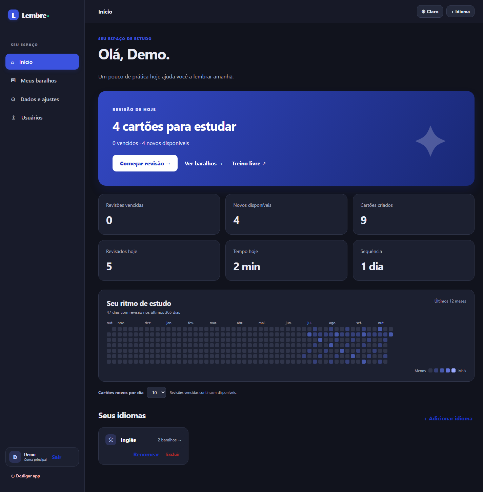
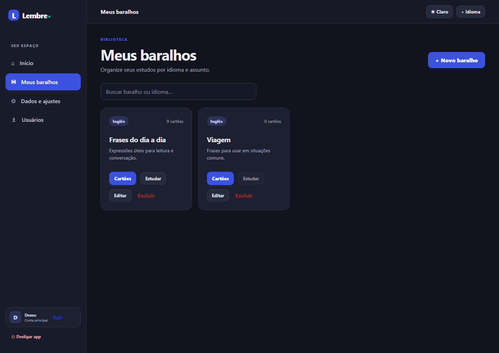
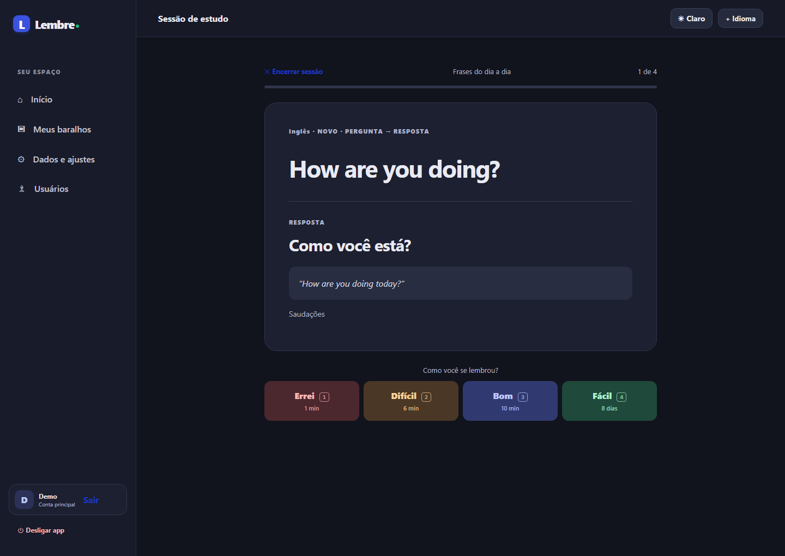

# Lembre

Flashcards para estudar idiomas, com revisão espaçada, interface em português e uso no PC ou no celular pela rede de casa. O projeto nasceu para estudo pessoal de inglês e permite criar outros idiomas e baralhos.

> As imagens abaixo usam uma conta e cartões fictícios. Nenhum banco de dados pessoal faz parte deste repositório.

## O que já funciona

- Cartões em um ou dois sentidos, com exemplos, observações, negrito, grifo e áudio opcional.
- Revisão espaçada com FSRS e prévia do próximo intervalo para cada avaliação.
- Limite diário configurável de cartões novos e limite opcional por sessão; escolha estudar só novos, só revisões vencidas ou ambos. O que não couber permanece pendente.
- Fila embaralhada dentro dos grupos de vencidos e novos; treino livre sem alterar o agendamento.
- Idiomas, baralhos, busca, modo escuro e mapa de atividades dos últimos 365 dias.
- Contas locais separadas, backups automáticos, exportação e restauração.
- Acesso opcional pelo celular na mesma rede Wi-Fi, enquanto o PC estiver ligado.

| Baralhos | Sessão de revisão |
| --- | --- |
|  |  |

[Ver a tela de cartões e seus destaques](docs/images/cartoes.png).

## Rodar no computador

Requisitos: Node.js 22 ou mais recente e npm. No terminal, dentro da pasta do repositório:

~~~powershell
npm ci
npm run build
npm start
~~~

Abra http://127.0.0.1:4173 e crie a conta principal na primeira visita. Os dados são criados em uma pasta irmã chamada lembre-data, fora do repositório. Para escolher outra pasta, defina a variável de ambiente LEMBRE_DATA_DIR antes de iniciar.

Durante o desenvolvimento, use npm run dev e abra http://127.0.0.1:5173.

## Celular pela rede de casa

Depois de criar a conta principal no próprio PC, inicie com:

~~~powershell
npm run start:lan
~~~

Abra no celular o endereço privado exibido no terminal, por exemplo http://192.168.1.10:4173. PC e celular precisam estar na mesma rede. Se o Windows perguntar, libere somente em redes privadas. Não abra a porta 4173 na internet.

## Iniciador para Windows

O código do iniciador está em launcher/Program.cs. Em um Windows com o compilador C# do .NET Framework disponível, execute launcher/build-launcher.ps1 para gerar Lembre.exe na pasta do projeto. Ele inicia o servidor, abre o navegador e reutiliza o processo quando já está ligado. A conta principal pode usar Desligar app na barra lateral para encerrar o servidor.

O executável gerado localmente não é incluído no Git. É necessário instalar o Node.js, executar npm ci e npm run build antes de usá-lo.

## Dados e backups

O SQLite fica em lembre-data/lembre.sqlite, ao lado da pasta do projeto. O servidor cria backups automáticos na subpasta backups e mantém as sete cópias automáticas mais recentes. A interface permite exportar e restaurar dados de uma conta; a conta principal também pode criar e restaurar backups completos. Áudios anexados fazem parte do banco e das exportações.

Arquivos SQLite, backups, exportações, senhas e sessões não entram no Git. As capturas desta página foram feitas com um banco temporário fictício.

## Estrutura

- web/: React, TypeScript, Vite e estilos.
- server/: Fastify, SQLite, autenticação, estudo e backups.
- launcher/: iniciador opcional para Windows.
- docs/: especificação e imagens de demonstração.

A [especificação de produto e arquitetura](docs/PRODUCT_ARCHITECTURE.md) registra as decisões e regras de estudo. Importação do Anki e sincronização pela internet ainda não estão implementadas.

## Licença

Distribuído sob a [licença MIT](LICENSE). Você pode usar, modificar e compartilhar o código, inclusive comercialmente, mantendo o aviso de direitos autorais e a licença.
